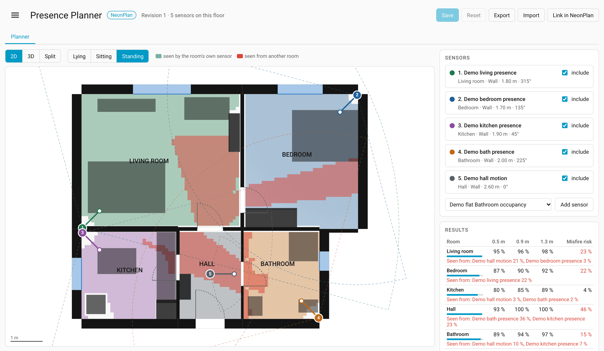
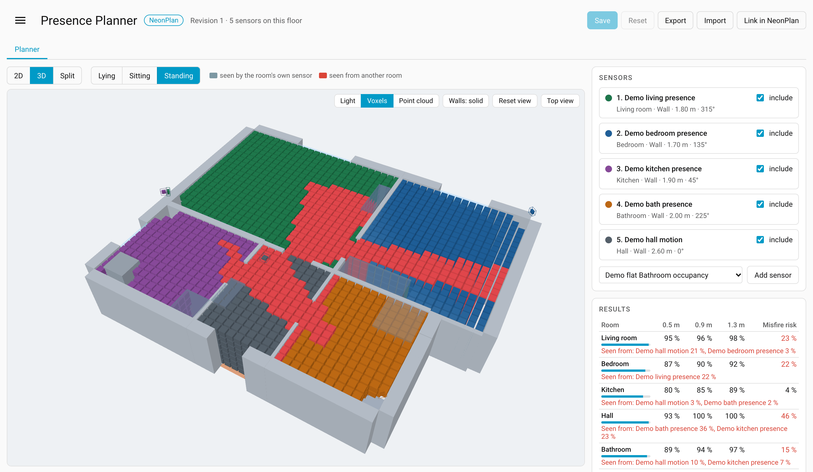

# Presence Planner


Plan presence and motion sensors on your floor plan in Home Assistant: coverage per room and height, false-trigger risk, suggested sensor spots and a cleaned room occupancy. With its own editor and a 3D view, standalone or together with [NeonPlan 3D](https://github.com/Mastershort/neonplan3d).

**Beta 0.1.0.** The results are a geometric planning aid. Check sensor spots and automations in your own home. Presence Planner is independent of NeonPlan 3D and of the sensor manufacturers.

## Screenshots

The images show an invented demo flat with five simulated sensors.

<picture>
  <source media="(prefers-color-scheme: dark)" srcset="docs/images/planner-2d-dark.png">
  
</picture>



More images in [docs/images](docs/images): the 3D light mode, the best-spot suggestion, the floor plan editor and the room entities in a dashboard.

## Requirements

- Home Assistant **2026.10.2 or newer** within the supported 2026.10 series. Later HA series need their own compatibility check.
- Admin rights to set up, import and save. Logged-in users can read and export the whole plan and the sensor information.
- A browser with WebGL2 for the 3D view. The 2D planner also works without 3D.
- NeonPlan is optional. The adapter was tested with 1.19.2 and 1.21.0. It uses internal runtime data, not a guaranteed public API. Check it separately after a NeonPlan update.

## Installation

1. In HACS, open the menu "Custom repositories" and add the URL `https://github.com/DigitalIQ/presence-planner` with the category **Integration**.
2. Download Presence Planner and restart Home Assistant.
3. Under **Settings → Devices & services → Add integration**, search for **Presence Planner** and confirm.
4. Open the **Presence Planner** entry in the sidebar.

Alternatively, copy the complete folder `custom_components/presence_planner` to `<HA config>/custom_components/presence_planner`, restart and add the integration. The frontend bundles are included; Home Assistant does not need Node.js.

Inclusion in the HACS default list is a separate step ([hacs/default#12395](https://github.com/hacs/default/pull/12395)). Until it is merged, install Presence Planner as a custom repository.

## Setup

The integration options offer three plan sources:

- **Automatic:** use a compatible, loaded NeonPlan, otherwise your own plan.
- **NeonPlan:** prefer NeonPlan. If the connection is missing or structurally incompatible, an error is shown and the planner falls back to your own plan.
- **Own floor plan:** create or import floors and rooms in the editor and assign them to HA areas.

Add sensor entities, place them, check their profiles and save your changes. Each room gets coverage, false-trigger risk and cleaned occupancy. Profiles preset field of view and range; check the mounting yourself.

With NeonPlan, **Save** writes the sensor placement fields and the planner's own extras. The link button adds an entry to NeonPlan's menu only when you click it. Floor plan imports change your own plan, not the NeonPlan building.

## Backup and import

**Export** downloads `presence-planner-backup.json`. The outer format is a NeonPlan exchange format. The extra field `presence_planner` holds the complete native plan and the sensor spots. A later planner import therefore also restores HA assignments, door contacts, wall values and background images. NeonPlan can use the outer exchange data and ignores the planner extras.

An import **replaces** your own plan and its sensor list. A file without sensors therefore clears your existing sensor spots. Export first if you want to keep the old state. Plain NeonPlan exchange files cannot restore assignments that their format does not contain.

Before saving, the structure and the computing effort are checked. Limits include 16 floors, 64 rooms per floor, 128 points per room, 64 sensors and 100,000 conservatively estimated grid operations per floor and grid spacing. Additional total and geometry budgets can reject complex plans earlier. A failed import does not replace the last valid plan. Old data rejected while loading stays on disk and is not computed.

## Model limits

- Coverage is a model calculation from field of view, range, height and simplified material damping. It is not a measured detection quality and not a manufacturer guarantee.
- Reflections, people, pets, furniture and special wall materials can lead to different results in practice.
- False-trigger risk and the precomputed spill treat open doors as the worst case. The echo cleaning respects assigned contacts; when a view crosses several doors, all of them must be open. Unknown contacts count as open.
- Openings in freestanding walls are currently not modelled as passages in either core. Normal room doors and windows are supported.
- The echo cleaning can suppress real simultaneous presence when reports fall inside the echo window. Check hold time, echo window and spill threshold in daily use.
- Do not base safety-critical alarm, access or emergency functions on the cleaned occupancy alone.

## Privacy

All calculations run locally in Home Assistant and in the browser, with no telemetry and no cloud account. Background images are stored as inline image data; external image URLs are rejected. The plan and the planner's own sensor fields are stored in `<HA config>/.storage/presence_planner` and are therefore part of HA backups. Exports contain private data about your home and your sensors.

The sidebar entry is also visible to logged-in non-admin users. They can read and export the complete plan. There is no additional filtering by HA area or by single entity.

## Updating and removing

Create an HA backup before updating. Update in HACS, restart Home Assistant and check the plan source, the sensor spots and the three room entities. After a NeonPlan update, test its connection separately.

To remove Presence Planner, first delete the integration under Devices & services, then remove the files through HACS and restart Home Assistant. This does not undo sensor placements in NeonPlan. Remove the optional NeonPlan menu button there yourself if needed. A saved planner file stays as a data source; delete it only on purpose and with a matching backup.

## Development and checks

Use Python 3.14.2 or newer and Node.js 22:

```sh
python3 -m venv .venv
.venv/bin/pip install -r requirements_test.txt
npm ci
.venv/bin/ruff check custom_components tests scripts
.venv/bin/python -m pytest -q
npm test
npm run build
python3 scripts/check_release.py
git diff --exit-code custom_components/presence_planner/frontend
```

The bundle diff checks an already committed build. HA and the test plugin are pinned to compatible versions. The local package check verifies metadata, documentation, icon and shipped files. The official HACS check runs in GitHub Actions together with hassfest. There is no automatic release workflow.

Report bugs with your HA version, plan source, NeonPlan version and reproducible steps under [Issues](https://github.com/DigitalIQ/presence-planner/issues). Use synthetic data for public examples, and remove real floor plans and credentials before sharing.

## License

MIT. See [LICENSE](LICENSE).
